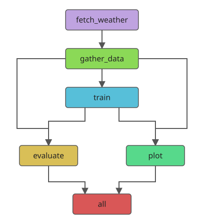

# neural_ode

A Python package for forecasting and clustering irregular trajectories with a
Latent ODE and Gaussian mixture prior. It includes data preparation, synthetic
trajectory generation, training, evaluation and plotting, with a Snakemake
workflow for Oxford weather and a Docker image for running that workflow.

This project is part of the Research Software Engineering Course at the
University of Oxford and builds upon work done by Felix Breach at the
Adaptive Brain Lab (University of Cambridge).

[Read the documentation](https://neural-ode.readthedocs.io/en/latest/index.html)
for the getting started guide and API reference.

## Install locally

Requires Python 3.11 or later. From the repository root, create a virtual
environment and install the package:

```sh
python -m venv .venv
source .venv/bin/activate
python -m pip install -e .
```

The distribution name is `neural-ode`; the import name is `neural_ode`.
The Snakemake example and documentation build also require Python 3.11 or later.

## Python API quick start

To train the model, the user must provide an appropriate trajectory or csv path to prep_data.
The input data must contain one row per trajectory observation with an ID, a
numeric time, and one column per feature. The final 30% of each trajectory is reserved for forecasting.
Labels are optional metadata for plotting and evaluation. Missing feature values are supported. 
Input data is long format: one row per trajectory observation, with an ID, a
numeric time and one column per feature. Labels are optional metadata for
plotting and evaluation. Missing feature values are supported.

This example generates training and test data in memory, trains a model and
evaluates forecasts on the separate test set:

```python
from neural_ode import (
    evaluate_performance, generate_synthetic_data,
    plot_predicted_trajectories, predict, prep_batches, prep_data,
    train_fit_gmm, train_finetune, train_pretrain,
)

train_df, test_df = generate_synthetic_data(
    n_train=60, n_test=18, n_classes=3, n_features=2,
    length=20, irregularity=0.4, noise=0.1, seed=94,
)
data_options = {
    "id_col": "trajectory_id",
    "time_col": "time",
    "feature_cols": ["feature_0", "feature_1"],
    "label_col": "label",
    "cutoff": 0.7,
    "cutoff_mode": "fraction",
}
data = prep_data(train_df, **data_options)
loaders = prep_batches(
    data, batch_size=16, val_split=0.2, normalize=True, seed=94,
)
pretrained = train_pretrain(
    loaders, model_config={"latent_dim": 6, "n_clusters": 3},
    epochs=20, seed=94,
)
gmm = train_fit_gmm(pretrained.model, loaders, seed=94)
finetuned = train_finetune(gmm.model, loaders, epochs=20, seed=94)

test_data = prep_data(test_df, **data_options)
test_loader = prep_batches(
    test_data, batch_size=16, val_split=0, normalize=True, shuffle=False
).train
scores = evaluate_performance(finetuned.model, test_loader)
predictions = predict(finetuned.model, test_data)
figures = plot_predicted_trajectories(predictions)
print(scores)
```

`prep_data` also accepts a CSV path. The cutoff reserves the final 30% of each
trajectory for forecasting. Training consists of reconstruction pretraining,
GMM fitting and fine-tuning with the mixture prior.

`evaluate_performance` reports masked forecast MSE, label-based clustering
scores (NMI, ARI and matched accuracy), and label-free clustering scores
(silhouette, Davies–Bouldin and Calinski–Harabasz). Unavailable metrics are
`None`; clustering metrics are evaluated after GMM fitting. Evaluation converts
separately normalised test batches to the model's training scale. Predictions
and their plots use that training scale.

The synthetic generator returns two DataFrames without writing files. The user can
specify the trajectory length, observation times, noise, any missing values, and random 
seeds for generation. 

For a command-line example using your own CSV, see
[`examples/basic_workflow.py`](examples/basic_workflow.py). It expects `id`,
`time` and `label` columns, with the remaining columns treated as features:

```sh
python examples/basic_workflow.py path/to/trajectories.csv --epochs 20
```

## Run the weather example with Snakemake

With Python 3.11 or later, install the optional workflow dependencies and run
these commands from the repository root:

```sh
python -m pip install -e '.[workflow]'
snakemake --cores 1 --dry-run
snakemake --cores 1
```

The [Snakefile](Snakefile) fetches Oxford weather using
[`examples/forecast/fetch_oxford_weather.py`](examples/forecast/fetch_oxford_weather.py),
splits the prepared windows, trains a model on weather data from 30 context days,
evaluates it and plots the predicted weather over the next 7 days.
The first run requires internet access to the Open-Meteo archive API. The DAG for the
Snakemake workflow is shown below.



Evaluation and plotting both depend on the trained model and can run
independently once training finishes. The `all` target collects their final
outputs. The diagram's Mermaid source is available in
[`examples/figures/dag.mmd`](examples/figures/dag.mmd).

Edit [`examples/config.yaml`](examples/config.yaml) to set archive dates,
preparation, model, and training parameters. Outputs go to
`results/oxford_weather/`:

| Output | Contents |
| --- | --- |
| `data/train.csv`, `data/test.csv` | Chronologically split weather windows |
| `model.pt` | Trained model weights and reconstruction metadata |
| `history.json` | Per-epoch pretraining and fine-tuning metrics |
| `metrics.json` | Evaluation on the separate test set |
| `figures/input.pdf`, `figures/predictions.pdf` | Test inputs and forecasts, one page per feature |
| `figures/training_loss.pdf` | Training loss, one page per training phase |
| `logs/` | One log per workflow stage |

The fetched windows are cached at
`examples/forecast/data/oxford_weather_windows.csv`, shared with the standalone
[weather example](examples/forecast/README.md). The default archive dates are
1 January 2021 to 31 December 2025; change `weather.end_date` to extend the
dataset. Existing cached windows are reused when their fetch inputs and
parameters are unchanged.

The latest 20% of windows form the test set. Within the earlier data, the latest
20% form validation. Windows overlapping a later split's dates are discarded,
so training, validation and test sets share no observation dates. Consequently,
the retained proportions differ from the requested fractions. Weather has no
class labels, so NMI, ARI and matched accuracy are unavailable.

Completed stages are reused when their inputs and declared parameters are
unchanged. Changing training parameters reruns training and downstream jobs;
changing only `examples/scripts/plot.py` reruns plotting. To use another output
directory or configuration file:

```sh
snakemake --cores 1 --config output_dir=results/another_run
snakemake --cores 1 --configfile path/to/config.yaml
```


## Run the weather workflow with Docker

Install Docker and start its daemon. Run the
following commands from the repository root. The image provides Python 3.12,
CPU-only PyTorch, the package and Snakemake; a local Python environment is not
required for this route.

Build the image from the [Dockerfile](Dockerfile):

```sh
docker build -t neural-ode .
```

Run the complete weather workflow and keep its outputs on your machine:

```sh
mkdir -p results
docker run --rm \
  --mount type=bind,source="$(pwd)/results",target=/app/results \
  neural-ode
```

The default command is `snakemake --cores 1`. It fetches the configured weather
archive, trains and evaluates the model, and creates the PDFs listed above.
The first fetch requires internet access. View the saved model, metrics, logs
and figures under `results/oxford_weather/` on the host.

The image runs as the non-root user `runner`, so mounted output directories
must be writable by that user. The bind mount retains outputs when `--rm`
removes the container. Running `docker run --rm neural-ode` without a mount
also executes the workflow, but its outputs disappear when the container
exits. See [Docker's bind mount documentation](https://docs.docker.com/engine/storage/bind-mounts/)
for how host directories are shared with containers.

The command above persists only `results/`. Downloaded weather windows and
Snakemake metadata remain inside the container, so a fresh container fetches
the archive again and can rerun completed stages.

To preview the jobs without executing them, override the default command:

```sh
docker run --rm neural-ode snakemake --cores 1 --dry-run
```

The image contains a copy of `examples/config.yaml` from build time. To use
an edited host configuration without rebuilding, mount that file read-only:

```sh
docker run --rm \
  --mount type=bind,source="$(pwd)/results",target=/app/results \
  --mount type=bind,source="$(pwd)/examples/config.yaml",target=/app/examples/config.yaml,readonly \
  neural-ode
```

Keep `output_dir` under `results/` to retain outputs through the mount above.
Rebuild the image after changing package code or workflow scripts. The
[.dockerignore](.dockerignore) excludes local environments, credentials,
Snakemake metadata, downloaded weather data and generated results from the
build context. Dependency versions are not locked, so rebuilding can install
different versions.

The [standalone weather example](examples/forecast/README.md) also provides
commands for forecasting the next seven days from recent observations. Those
commands use their own checkpoint format. The Docker image runs the root
workflow, which evaluates held-out historical windows.

## Documentation

For a daily seven-day forecast CSV without retraining, use the explicit
`snakemake --cores 1 live_forecast` target. The
[daily forecast setup guide](examples/forecast/README.md#daily-inference-with-snakemake)
uses the checkpoint included in the repository and covers the 08:17 UTC GitHub
Actions schedule with downloadable CSV artifacts.

The [Read the Docs site](https://neural-ode.readthedocs.io/en/latest/index.html)
contains the getting-started guide and API reference generated from the
NumPy-style docstrings. To build the Sphinx documentation locally:

```sh
python -m pip install -e ".[docs]"
python -m sphinx -b html -W --keep-going docs docs/_build/html
```

Open `docs/_build/html/index.html` to view the local build.

## Development

Install the development and workflow dependencies, then run the checks used
by the test CI job:

```sh
python -m pip install -e '.[dev,workflow]'
ruff check .
python -m pytest
```

The workflow is tested using an offline proxy for the weather data; the integration test
checks the basic functionality of the workflow including saving outputs, plotting, and running with
varying parameters. It also checks that chronological splits share
no observation dates. The integration test is skipped when Snakemake is unavailable.

## Source and licence

The package is extracted from research code in the parent workspace. See
[`NOTICE.md`](NOTICE.md) for provenance and the current restrictions on
redistribution, and [`LICENSE.md`](LICENSE.md) for the licence status.
